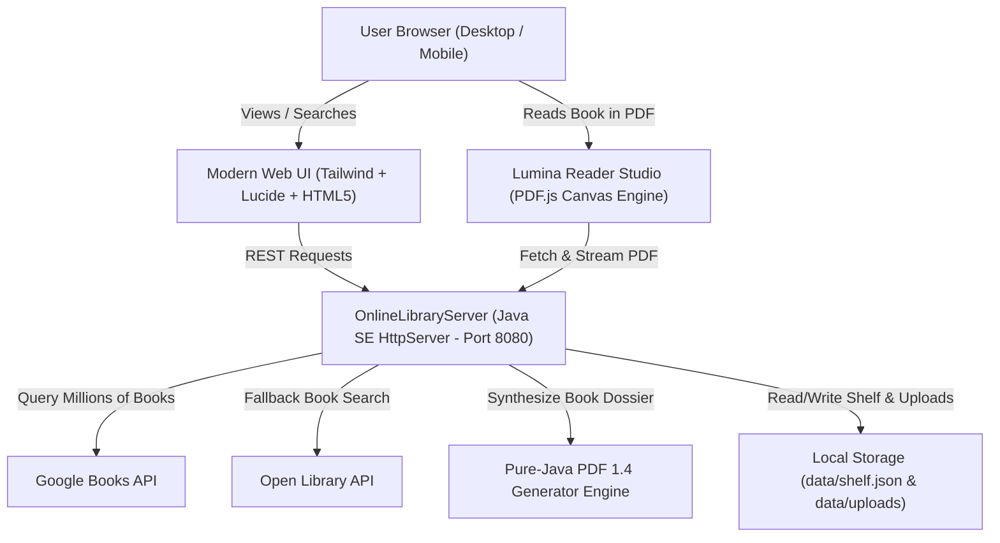

# 📚 Lumina — Digital Online Library & Universal PDF Reader

> A full-stack, enterprise-grade Online Library and PDF Reading Studio engineered in **Java** with zero third-party dependencies, featuring real-time worldwide book search, in-browser PDF reader, personal library shelf, and an on-the-fly Java PDF Dossier generator.

---

## 🎓 Institutional Protocol for Educational Institutes & Colleges

**Lumina serves as a turnkey, self-hosted digital library protocol designed specifically for educational institutes, universities, schools, and research academies.** 

Instead of relying on fragmented file shares or costly third-party subscriptions, academic institutions can deploy this protocol on local campus servers or private clouds to provide an all-in-one digital learning hub:

- **🏛️ Personalized Campus Libraries**: Universities and academic departments can curate and host customized subject libraries, departmental textbooks, course readers, research papers, syllabus documents, and historical archives.
- **👨‍🎓 Universal Student Access**: Students across campus can easily connect over the local network (`http://library-server:8080`), instantly search millions of global literature titles alongside their school's syllabus materials, and read directly in the built-in PDF viewer.
- **📝 Academic Annotation & Study Logs**: Students can maintain dedicated reading logs, page progress tracking, and margin notes for each subject or research topic without losing their spot.
- **📑 Instant PDF Dossier Generation**: Students and faculty can generate structured executive reading dossiers and discussion questions in seconds using the pure-Java PDF synthesis engine.
- **🔒 Privacy, Zero-Cost & Zero Tracking**: Built with zero external commercial advertising, no user-tracking data collection, and 100% self-hosted on lightweight Java standard runtime.

---

## 🌟 Key Features

### 1. 🔍 Worldwide Instant Book Discovery
- **Search Millions of Volumes**: Query any book published globally using live integration with Google Books and Open Library APIs.
- **Dynamic Category Filters**: Filter immediately by *Fiction & Classics*, *Computer Science & AI*, *Philosophy*, *Science*, *History*, and *Psychology*.
- **Debounced Smart Search**: Instant fluid search with keyboard shortcut (`/` to focus search bar).

### 2. 📖 Built-in PDF Reading Studio
- **Mozilla PDF.js Integration**: Read actual books and documents directly inside your browser with high-DPI crisp canvas rendering.
- **Reading Modes & Themes**:
  - 🌙 **Night / Dark Mode** (High-contrast, sleek slate theme)
  - 📜 **Warm Sepia Mode** (Gentle parchment paper tone for reduced eye strain)
  - ☀️ **Clean Light Mode** (Classic crisp paper white)
- **Fluid Reading Controls**: Next/Prev page, direct page number jump, zoom in/out, fit to width, and fullscreen mode (`F`).
- **Persistent Reading Progress & Notes**: Remembers the exact page you left off on and auto-saves your personal margin annotations to your local shelf.

### 3. ⚡ Pure Java PDF Dossier Generator
- **Zero-Dependency PDF 1.4 Synthesis**: Generates beautifully styled, multi-page PDF reading briefs and dossiers directly in Java on the fly!
- Each dossier includes:
  - Professional title block with verified publisher & categorization
  - Structured executive synopsis & themes
  - Core takeaways & analytical highlights
  - Guided reflection questions
  - Lined study notes & annotation margins
- Downloadable and viewable right inside the reader with one click.

### 4. 🗄️ Personal Shelf & Custom PDF Uploads
- **My Shelf**: Save books with statuses (*Want to Read*, *Currently Reading*, *Completed*).
- **Upload Local PDFs**: Drag & drop any `.pdf` document from your computer to store in your private library and read anytime with bookmarks.
- **Persistent Local Store**: Saved books and notes persist seamlessly in `data/shelf.json`.

### 5. 🏛️ Bundled Public Domain Masterpieces
Includes full offline PDF editions of timeless classics ready to read immediately:
- *The Art of War* — Sun Tzu
- *Frankenstein* — Mary Shelley
- *The Adventures of Sherlock Holmes* — Arthur Conan Doyle
- *Pride and Prejudice* — Jane Austen
- *Alice's Adventures in Wonderland* — Lewis Carroll

---

## 🚀 How to Run the Project

### Option 1: One-Click Windows Launcher (Recommended)
Simply double-click:
```bat
run.bat
```
This automatically compiles the Java sources, launches the server on port `8080`, and opens your default web browser to `http://localhost:8080`.

### Option 2: Command Line (Java SE)
```bash
# 1. Compile Java source
javac -encoding UTF-8 -d bin src/main/java/com/onlinelibrary/OnlineLibraryServer.java

# 2. Run the server
java -cp bin com.onlinelibrary.OnlineLibraryServer
```

### Option 3: Maven Build (IDE)
If using IntelliJ IDEA, Eclipse, or VS Code, open this folder as a Maven project and run:
```bash
mvn compile exec:java -Dexec.mainClass="com.onlinelibrary.OnlineLibraryServer"
```

Once running, navigate to:
👉 **`http://localhost:8080`**

---

## 📡 REST API Documentation

| Method | Endpoint | Description |
|---|---|---|
| `GET` | `/api/books/search?q={query}&category={cat}` | Searches Google Books / Open Library and returns unified book items |
| `GET` | `/api/books/featured` | Returns curated classic masterpieces with ready PDF editions |
| `GET` | `/api/shelf` | Retrieves all saved books from personal shelf |
| `POST` | `/api/shelf` | Adds or updates a book on user's shelf |
| `DELETE` | `/api/shelf?id={id}` | Removes a book from user's shelf |
| `POST` | `/api/shelf/progress` | Updates current reading page, notes, and completion status |
| `POST` | `/api/upload?title={title}&author={author}` | Uploads a local PDF file into `data/uploads/` and adds to shelf |
| `GET` | `/api/pdf/proxy?url={url}` | Proxies remote public domain PDFs with CORS headers for reader |
| `GET` | `/api/pdf/generate?title=...&author=...` | Generates on-the-fly pure Java PDF dossier |
| `GET` | `/api/health` | Health check endpoint |

---

## 📂 Project Directory Structure

```
online library/
├── .jdk/                             # Portable Java SE Runtime & Compiler
├── bin/                              # Compiled Java class files
├── data/
│   ├── shelf.json                    # User shelf & bookmark persistence
│   └── uploads/                      # Uploaded custom user PDFs
├── scripts/
│   └── generate_samples.ps1          # Classic public domain PDF generator
├── src/
│   └── main/
│       ├── java/
│       │   └── com/
│       │       └── onlinelibrary/
│       │           └── OnlineLibraryServer.java  # Main Java HTTP & PDF Server
│       └── resources/
│           └── static/
│               ├── css/
│               │   └── style.css     # Glassmorphism & responsive UI styles
│               ├── js/
│               │   ├── app.js        # Search, shelf sync, modal interactions
│               │   └── reader.js     # PDF.js canvas reader & theme engine
│               ├── samples/          # Bundled classic PDF volumes
│               ├── index.html        # Main Library Discovery Web App
│               └── reader.html       # Dedicated In-App PDF Reader Studio
├── pom.xml                           # Standard Maven build configuration
├── run.bat                           # 1-click Windows startup script
└── README.md                         # Project documentation
```

---

## 💻 System Architecture



---

&copy; 2026 Lumina Online Library. Engineered with Java.
